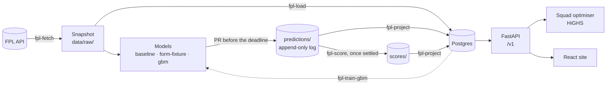

# fpl-predictor

[](https://github.com/amanwaseem/fpl-predictor/actions/workflows/ci.yml)
[](https://fpl-predictor-aman.fly.dev)
[](LICENSE)

Points predictions for every Fantasy Premier League player, **committed to this repository
before each gameweek's deadline**, scored against what actually happened, and never rewritten.

Most published FPL models report accuracy on a historical holdout, which gives the author every
chance to tune against the test set. This project commits its predictions ahead of time instead,
so the claim is falsifiable and the receipts are in the git history. CI refuses any change to an
entry already in the log, so the track record (bad weeks and missed ones included) is exactly
what the history shows.

<picture>
  <source media="(prefers-color-scheme: dark)" srcset="https://github.com/amanwaseem/fpl-predictor/releases/download/site-screenshots/home-dark.png">
  
</picture>

On top of the log sit a squad optimiser, a public API and a website:

- **Website:** [fpl-predictor-aman.fly.dev](https://fpl-predictor-aman.fly.dev): this week's
  top picks, every player's predictions, the track record, and "optimise my team"
- **API:** [interactive docs](https://fpl-predictor-aman.fly.dev/docs), read-only over the log

```bash
curl -s https://fpl-predictor-aman.fly.dev/v1/scorecard
```

### The record so far

2026/27, pooled over every player in every scored gameweek, from
[`scores/cumulative.json`](scores/cumulative.json) (actuals from snapshot `20261110T235748Z`,
taken once the latest of them settled). Lower MAE is better; `form` is FPL's own form figure,
the naive prediction a model has to beat.

| Model | Role | Scored | Missed | MAE | `form` MAE | XI points | `form` XI points |
|---|---|---|---|---|---|---|---|
| `baseline-v1` | baseline | GW4, GW6, GW8, GW9, GW10 | GW5, GW7 | 1.056 | 1.223 | 283 | 226 |
| `form-fixture-v1` | main | GW6, GW8, GW9, GW10 | GW7 | 1.029 | 1.209 | 191 | 194 |
| `gbm-v1` | challenger | GW9, GW10 | | 0.978 | 1.116 | 119 | 126 |

"XI points" is what each model's best predicted starting eleven actually scored, summed over
its gameweeks. A missed gameweek had no entry before the deadline, and stays missed. Each row is
pooled over that model's own gameweeks, so the rows are not a ranking: a model logged later is
judged on fewer, and perhaps easier, weeks. To compare models, use the gameweeks they share, below.

<details>
<summary><b>Results so far</b>, gameweek by gameweek</summary>

Mean absolute error per player against FPL's `form`, Spearman rank correlation, and the actual
points of each one's best predicted XI. From `scores/gw*_*.json`, harness-v1.

| Gameweek | Model | MAE | Spearman | `form` MAE | XI points | `form` XI points |
|---|---|---|---|---|---|---|
| GW4 | `baseline-v1` | 1.153 | 0.713 | 1.277 | 56 | 32 |
| GW6 | `baseline-v1` | 1.031 | 0.747 | 1.228 | 49 | 38 |
| GW6 | `form-fixture-v1` | 1.028 | 0.744 | 1.228 | 30 | 38 |
| GW8 | `baseline-v1` | 1.114 | 0.728 | 1.377 | 50 | 30 |
| GW8 | `form-fixture-v1` | 1.103 | 0.729 | 1.377 | 49 | 30 |
| GW9 | `baseline-v1` | 0.948 | 0.781 | 1.075 | 62 | 62 |
| GW9 | `form-fixture-v1` | 0.958 | 0.776 | 1.075 | 55 | 62 |
| GW9 | `gbm-v1` | 0.951 | 0.774 | 1.075 | 69 | 62 |
| GW10 | `baseline-v1` | 1.037 | 0.772 | 1.158 | 66 | 64 |
| GW10 | `form-fixture-v1` | 1.029 | 0.777 | 1.158 | 57 | 64 |
| GW10 | `gbm-v1` | 1.006 | 0.778 | 1.158 | 50 | 64 |

A handful of gameweeks is too few to tell two models apart by eye; held-out backtests over past
seasons are what judge that ([`reports/gbm-v1.md`](reports/gbm-v1.md)).

</details>

## How it works

Every gameweek goes through the same loop, run by a scheduled GitHub Actions workflow:

1. **Snapshot.** The FPL API is saved to disk, timestamped and never edited, after the final
   press conferences and before the deadline.
2. **Predict.** Every logged model predicts every player's points from that one snapshot.
3. **Verify.** Each entry is checked against the snapshot that produced it.
4. **Commit.** The entries are merged into [`predictions/`](predictions/) before the deadline,
   through a pull request that CI checks.
5. **Score.** Once the gameweek settles, every entry is scored against what actually happened,
   beside naive comparators, into [`scores/`](scores/).

Three rules hold the loop together, and are enforced by code rather than by memory:

| Rule | Why |
|---|---|
| A committed prediction is never rewritten | A log that can be edited proves nothing. CI fails any change to a committed entry |
| Nothing after the deadline is used to predict a gameweek | A late entry is not evidence; a missed deadline stays missed |
| Raw data is never committed | Snapshots are large and regenerable |

## The models

Each logged model has a role ([ADR 0020](docs/adr/0020-one-baseline-one-main-model-one-challenger.md)):
a fixed baseline as the yardstick, the main model, and at most one challenger. A model that
cannot beat the baseline on held-out past seasons is never logged
([ADR 0007](docs/adr/0007-the-baseline-is-the-ship-gate.md)).

| Model | Logged from | What it does |
|---|---|---|
| `baseline-v1` | GW4 | Rolling form: recent minutes and scoring rate, adjusted for availability and fixture count. No training |
| `form-fixture-v1` | GW6 | Predicts each scoring component (minutes, goals, assists, clean sheets, saves, defensive contributions, bonus) separately, with last-season priors and opponent-aware team strength |
| `gbm-v1` | GW9 | LightGBM trained on ten past seasons: minutes in two stages, points by a Tweedie model ([held-out report](reports/gbm-v1.md)) |

Squad selection is a constrained optimisation over the predictions: an integer programme that
maximises expected points under the £100m budget, a valid formation, at most three players per
club, and the points cost of transfers, over one gameweek or a plan of up to six.

<picture>
  <source media="(prefers-color-scheme: dark)" srcset="https://github.com/amanwaseem/fpl-predictor/releases/download/site-screenshots/squad-dark.png">
  
</picture>

## Architecture



Git is the source of truth: Postgres holds a projection of the log that CI rebuilds and checks
against git on every pull request, plus the snapshots the API serves.

Everything runs on GitHub Actions:

| Workflow | When | What it does |
|---|---|---|
| `entry` | Hourly, acting in the window before each deadline | Snapshots the API, makes every model's entry, verifies it, and opens a PR that merges itself once CI passes |
| `ingest` | Daily | Snapshots the API and loads it into production, so results reach the site |
| `ci` | Every pull request, and every push to `main` | Lint, types, the tests on Linux and macOS, the database and API fuzzing, the image, the site's end-to-end tests, and the log's immutability |
| `deploy` | When `ci` passes on a push to `main` | Migrates, projects the log, deploys to Fly.io and smoke-tests the live URL |
| `deadline` | Hourly | Warns when a deadline is near with no entry |
| `uptime` | Hourly | Checks the live API and how fresh its data is |
| `backfill` | By hand | Loads the ten past seasons into production, as the learned model's training data |

## Tech stack

| Layer | What it uses |
|---|---|
| Prediction and evaluation | Python 3.13, with `requests` the only dependency at prediction time; LightGBM for training |
| Optimiser | Integer programming with [HiGHS](https://highs.dev) |
| Data | PostgreSQL with SQLAlchemy and Alembic; ten past seasons (~254,000 player-fixture rows) as training data |
| API | FastAPI, with an OpenAPI contract fuzzed in CI by schemathesis |
| Website | React, TypeScript and Vite, served by the API |
| Infrastructure | Docker, Fly.io, Neon Postgres, GitHub Actions for CI, deploys, daily ingest and the weekly entry |

## Quickstart

You need [uv](https://docs.astral.sh/uv/), and Docker for the database.

```bash
git clone https://github.com/amanwaseem/fpl-predictor && cd fpl-predictor
uv sync --locked && source .venv/bin/activate

uv run pytest                 # the test suite
fpl-fetch                     # snapshot the FPL API into data/raw/
fpl-entry --dry-run           # every model's predictions, into scratch/ (never the log)

make up migrate seed          # Postgres in Docker, with the snapshot and the log loaded
make web serve                # the site and API at http://127.0.0.1:8000
```

Every command, the database, the API and the frontend are covered in
[`docs/development.md`](docs/development.md).

## Project layout

```
fpl/                 the Python package
  ingest/            snapshots of the FPL API, and past seasons
  models/            the prediction models, and the trained-model registry
  log/               the prediction log: its schema, writing and verifying entries
  evaluation/        scoring and backtesting
  optimise.py        squad and transfer optimiser; plan.py: multi-gameweek plans
  db/                Postgres schema, migrations and loaders
  api/               the FastAPI service
web/                 the website (React + TypeScript)
predictions/         the log: one CSV per gameweek per model, append-only
scores/              each entry scored against what happened (derived)
reports/             readable digests of each entry (derived)
tests/               the test suite, laid out like fpl/
tools/               scripts the CI and scheduled workflows run
docs/                spec, runbook, development guide, operations and decision records
data/                snapshots and downloaded models (gitignored)
```

## Documentation

| Document | What it covers |
|---|---|
| [Development](docs/development.md) | Setup, every command, tests, database, API and frontend |
| [Spec](docs/spec.md) | What the system does: the log's schema, scoring and the rules |
| [Runbook](docs/runbook.md) | Making a prediction entry, step by step, by hand or automated |
| [Operations](docs/operations.md) | Monitoring, SLOs and incident response for the live service |
| [Deploy](docs/deploy.md) | One-time setup of Fly.io, Neon and the GitHub secrets |
| [Decision records](docs/adr/README.md) | Why the project is built the way it is, one decision at a time |
| [Contributing](.github/CONTRIBUTING.md) | How to propose a change, and the checks it must pass |
| [Security](.github/SECURITY.md) | How to report a vulnerability privately |

## Data

Sourced from the Fantasy Premier League API, which is unofficial and undocumented: its schema
can change without notice, which is why everything works from timestamped snapshots rather than
live calls. Snapshots are written to `data/raw/` and gitignored; `fpl-fetch` regenerates them.

This project is unaffiliated with the Premier League or Fantasy Premier League.

## Licence

[MIT](LICENSE)
